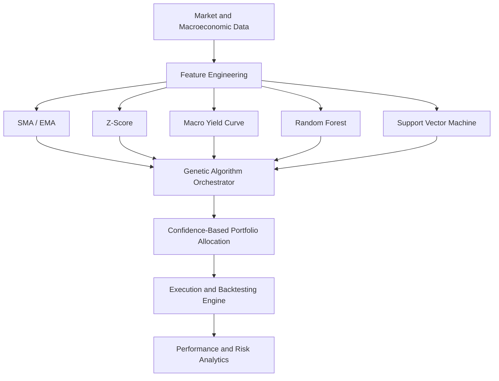

# Multi-Asset Trading with Quantitative Agents

**Systematic Trading | Quantitative Finance | Machine Learning**

LUISS Guido Carli University  
Data-Driven Models for Investment — Final Research Project  
November 2026

## Overview

This research investigates whether technical indicators, macroeconomic
information and machine learning signals can improve the historical
risk-adjusted performance of a multi-asset portfolio.

The framework combines five quantitative agents through a Genetic
Algorithm Orchestrator, translating heterogeneous signals into
systematic portfolio allocation decisions.

## Out-of-Sample Performance

**Evaluation period: January 2021 – October 2026**

| Strategy | CAGR | Volatility | Sharpe | Max Drawdown |
|---|---:|---:|---:|---:|
| **Multi-Agent Strategy** | **8.29%** | **5.75%** | **1.415** | **-7.47%** |
| SPY Buy & Hold | 14.96% | 16.62% | 0.922 | -24.50% |
| Equal Weight Buy & Hold | 8.65% | 8.96% | 0.972 | -14.70% |
| 60/40 Portfolio | 8.23% | 10.68% | 0.795 | -21.11% |
| Volatility Control | 7.47% | 7.21% | 1.035 | -13.77% |
| Macro Regime Long/Flat | 4.97% | 4.40% | 1.124 | -5.84% |


The strategy achieved the highest observed Sharpe ratio among
the evaluated portfolios, with substantially lower volatility
and drawdown than SPY.

Results are based on historical simulations before transaction
costs, assuming a zero risk-free rate.

A separately calibrated cost-aware configuration, including
2 bps commission and 1 bp slippage, achieved a Sharpe ratio
of 1.29 and a CAGR of 7.33%.

## System Architecture



## Investment Universe

| ETF | Asset Class |
|---|---|
| SPY | US Equities |
| IEF | Intermediate-Term US Treasuries |
| GLD | Gold |
| SHY | Short-Term US Treasuries |

## Quantitative Methodology

- Time-series feature engineering
- Technical and macroeconomic signal generation
- Random Forest and Support Vector Machine classifiers
- Genetic algorithm-based signal orchestration
- Walk-forward and purged temporal validation
- Confidence-based portfolio allocation
- Exposure constraints and systematic risk management
- Benchmark comparison and transaction-cost sensitivity

### Experimental Design

| Phase | Period |
|---|---|
| Model training | 2005–2020 |
| Allocation validation | 2016–2020 |
| Final out-of-sample evaluation | 2021–2026 |

Weekly signals are generated after market close and executed
at the next available trading session's open.

The selected portfolio is long-only, without leverage,
with a maximum allocation of 35% per ETF.

## Individual Research Contribution

**Gianluca Addorisio**

My principal contributions included:

- Research conception and quantitative research design
- Treasury duration and macroeconomic regime analysis
- Development-stage strategy evaluation
- Comparative analysis of passive and active benchmarks
- Temporal validation and portfolio accounting audits
- Technical documentation and final scientific review

## Repository Structure

```text
├── main.py
├── config.yaml
├── requirements.txt
├── src/
│   ├── agents/
│   ├── features.py
│   ├── strategy.py
│   ├── portfolio.py
│   ├── backtest.py
│   ├── execution_engine.py
│   └── evaluator.py
├── data/
├── docs/
└── tests/
```

Detailed methodology:
[Technical Documentation](docs/methodology.md)

## Installation and Execution

Python 3.13

```bash
python3.13 -m venv .venv
source .venv/bin/activate
python -m pip install -r requirements.txt
python main.py
```

The default configuration reuses archived data and trained models.

To execute the automated tests:

```bash
python -m unittest discover -s tests -p 'test_*.py'
```

## Research Limitations

The historical risk-adjusted performance does not establish
statistically significant alpha or prospective profitability.

The strategy's average target exposure was approximately 67%,
and its lower market participation contributed to its defensive
risk profile.

Further research would require exposure-matched benchmarks,
point-in-time macroeconomic data, additional independent
evaluation and more realistic execution assumptions.

## Authors and Academic Context

Developed collaboratively by:

- Gianluca Addorisio
- Giovanni Cafarelli
- Gabriele Di Raimondo

**Course:** Data-Driven Models for Investment  
**University:** LUISS Guido Carli  
**Teaching staff:** Prof. Antonio Simeone and Prof. Villy Edoardo De Luca

[Original Group Repository](https://github.com/Gab2112/ProjectAgentTrading26)

This repository is a portfolio presentation of the collaborative
academic project, based on the final submitted revision `6e4579d3`.

---

*For academic and research purposes only. Not investment advice.*
